<div align="center">

# cad-drawing

**从一句话到一张国标工程图。**

让 [Claude Code](https://claude.com/claude-code) 通过 COM 直接驱动 SolidWorks 与 AutoCAD：<br>
建模、装配、出视图、标注、规定画法、自检，一条流水线交付可打印的 GB 工程图（DWG + PDF）。

[](LICENSE)


</div>

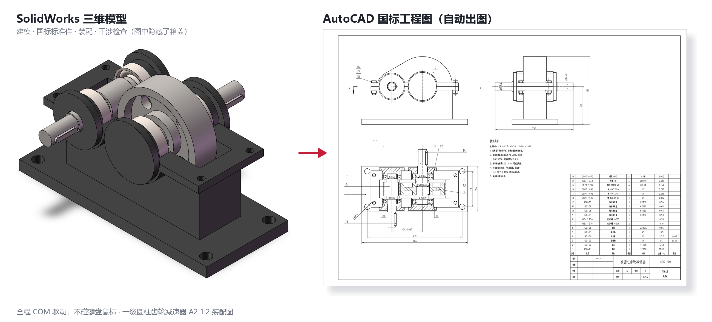

> ⚠️ **禁止商业化使用。** 本仓库仅供个人学习、研究和非营利用途，未经作者书面许可，不得用于任何商业目的（包括但不限于售卖、付费代画图纸、集成进商业产品或付费服务）。详见文末[许可证](#许可证)。

---

## 为什么是它

机械制图里最费时间的，从来不是“画线”，而是那些**要查标准、要守规矩、要反复对**的活：偏差查表、粗糙度朝向、剖面线方向、明细栏、尺寸有没有漏、文字有没有压线……

cad-drawing 把这些交给程序：

- 🧭 **投影交给 SolidWorks**：剖视、断面、斜视图的可见线由几何内核计算，不会漏一根孔口端面线。
- 📐 **国标交给规则**：GB/T 1800 公差、GB/T 131 粗糙度、GB/T 4457.5 剖面线、GB/T 4459 规定画法、GB/T 10609 标题栏，全部写进代码。
- 🔍 **质量交给自检**：出图后自动栅格化查压线，拿三维模型反查尺寸是否标全，报 0 处才交图。
- 🖐 **人不用碰鼠标**：全程 COM，不模拟键盘鼠标，跑的时候电脑照常用；改一个参数，重跑一分钟出新图。

## 工作流程

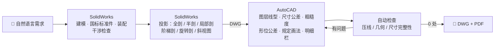

---

## 新能力一览

### 公差查表 · 符号自动放置

只写 `s.fit("%%C35k6")`，偏差按 GB/T 1800 自动查出并叠写；键槽宽、槽深按 GB/T 1095 给出。粗糙度、形位公差、基准只需指明“标在哪个面上”，位置由算法在几十个候选里挑——避开文字、尺寸和剖面线，读向符合 GB/T 131。

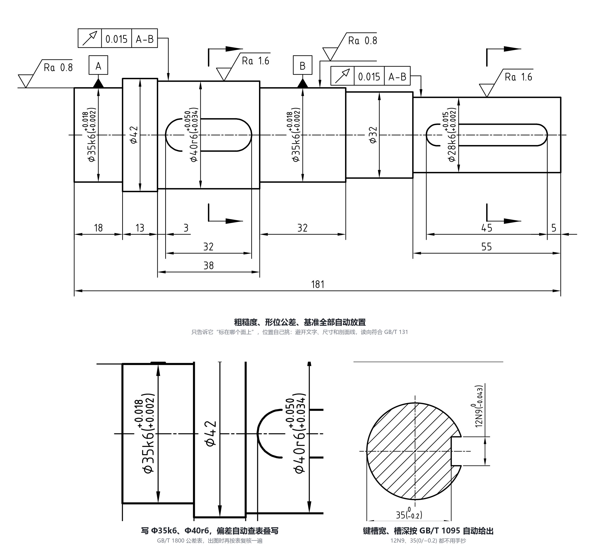

### 装配图剖面线自动错开

SolidWorks 导出的剖视里，所有零件都是同一方向、同一间距的斜线。`stagger_hatches()` 自动识别相邻零件并错开方向或间距，同一零件被孔、轴切开的几块保持一致（GB/T 4457.5）。

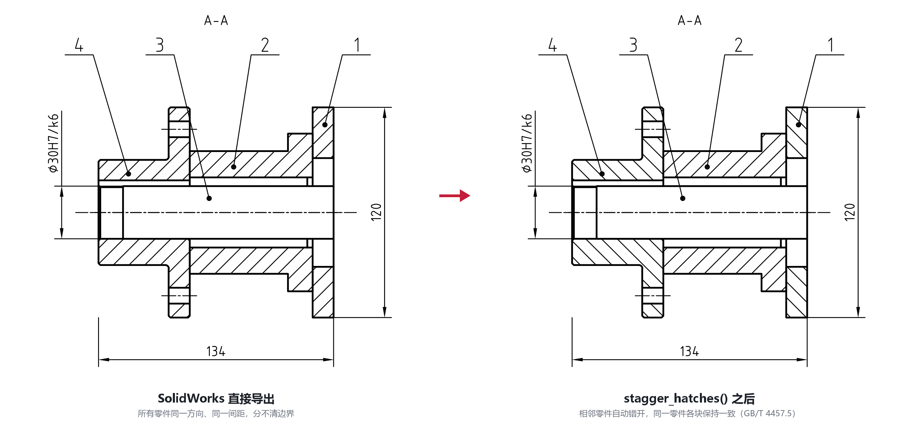

### 规定画法

外螺纹、矩形花键、圆柱螺旋压缩弹簧、蜗杆蜗轮、直齿锥齿轮、圆柱齿轮（含装配图中的啮合画法）——按 GB/T 4459 系列直接生成，模型只需建到光轴或齿根。

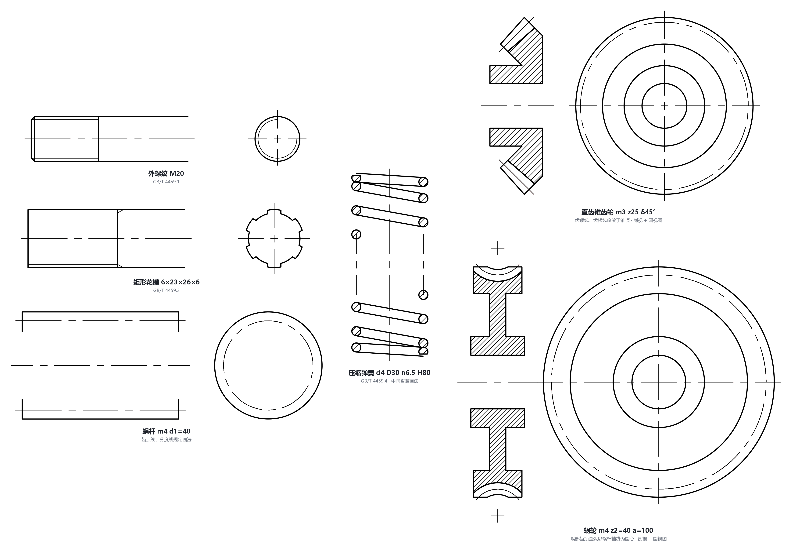

### 国标标准件，直接取自 Toolbox 尺寸库

不手抄尺寸表：直接读 SolidWorks Toolbox 的 GB 数据库（SQLite），按规格生成任意国标件，并写好代号、规格、材料、质量，明细栏一键取用。Toolbox 没有的毡圈单独建模。

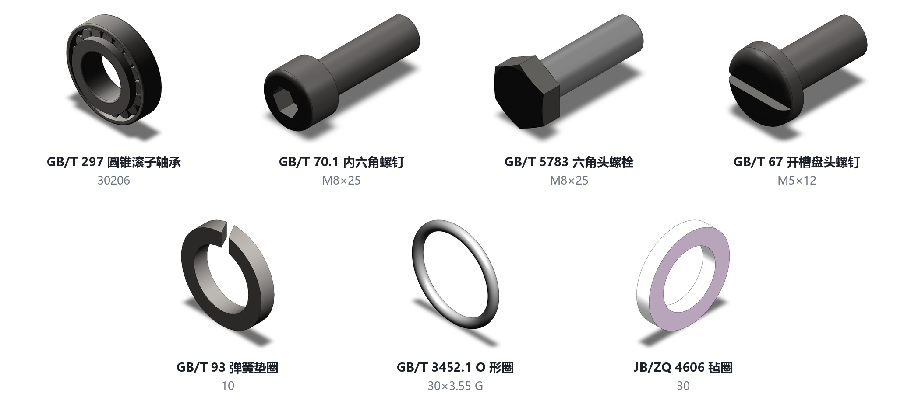

### 出图即自检

`check()` 把文字和尺寸临时染色出一张校核图，栅格化后逐字找压线、重叠，再查尺寸线间距、悬空引线、重复标注；`audit_dims()` 从三维模型读出每个平面和圆柱面，反查尺寸是否连通、有无封闭尺寸链、哪个直径漏标。下图右侧是这张图的真实运行输出。

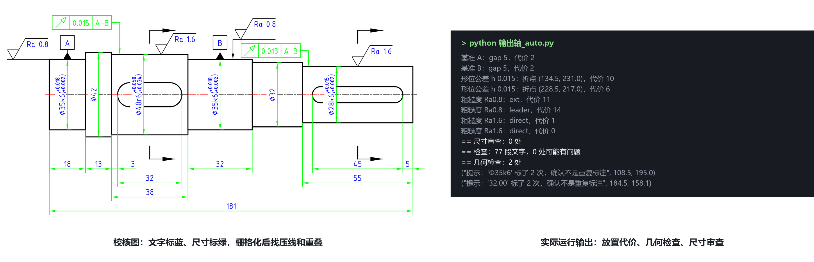

---

## 成果图

下面所有图纸都由仓库里的范例脚本**一键重跑生成**，未经手工修改（标题栏单位名称为占位字）。

### 一级圆柱齿轮减速器 · 成套图纸

装配图（A2 1:2）：三视图 + A-A 剖视，标准件按规格生成，明细栏里的代号、规格、质量自动填写，序号自动排布。


| 输出轴 · 移出断面、自动分排尺寸、圆跳动 | 大齿轮 · 轮齿规定画法、参数表 |
|---|---|
| 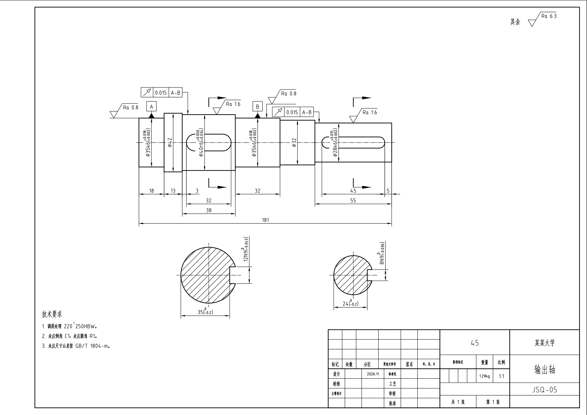 | 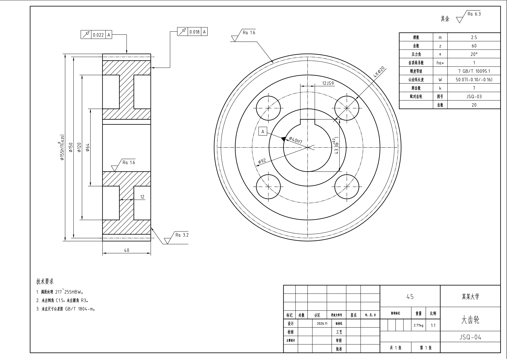 |
| **箱座** · 半圆轴承孔、平面度、尺寸审查 0 处 | **箱盖** · 局部剖、自动放置粗糙度与形位公差 |
| 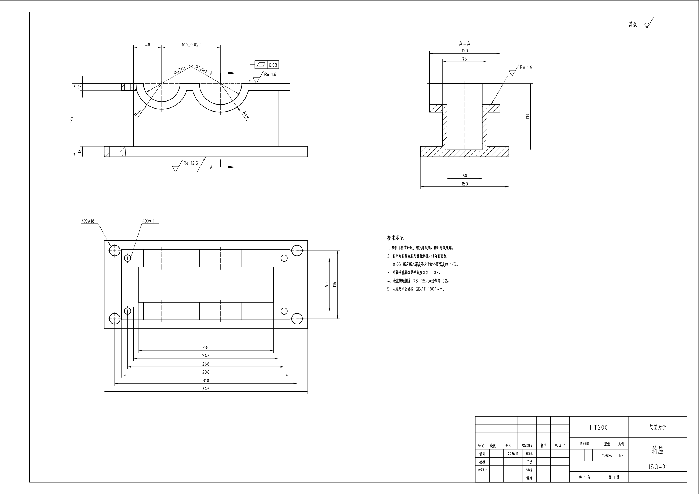 | 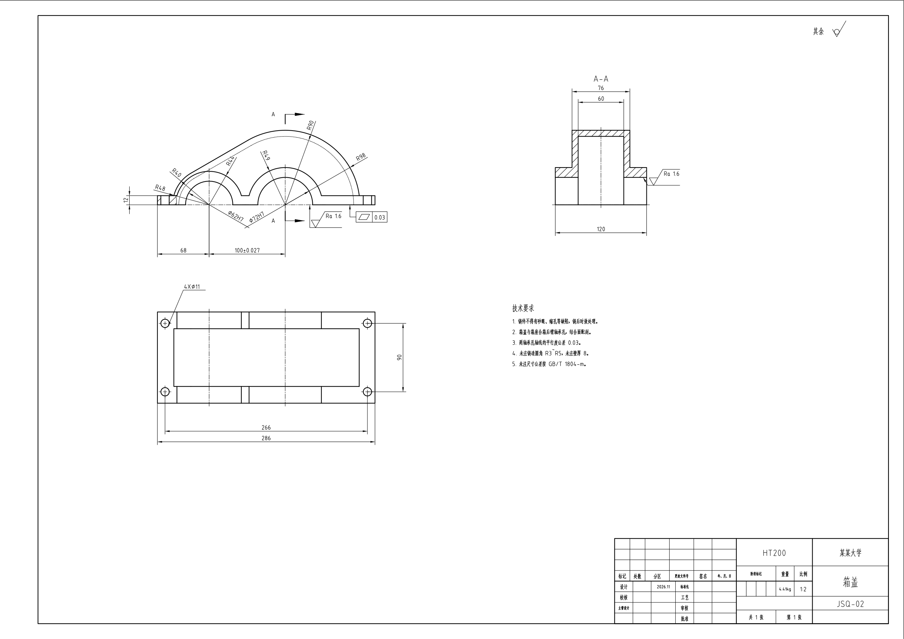 |

### 复杂表达方法

| 铸件轴承座 · 半剖、局部剖、局部放大 4:1、螺纹规定画法 | 旋转剖（拼接法，斜臂按真长展开）+ 局部斜视图转正 |
|---|---|
|  | 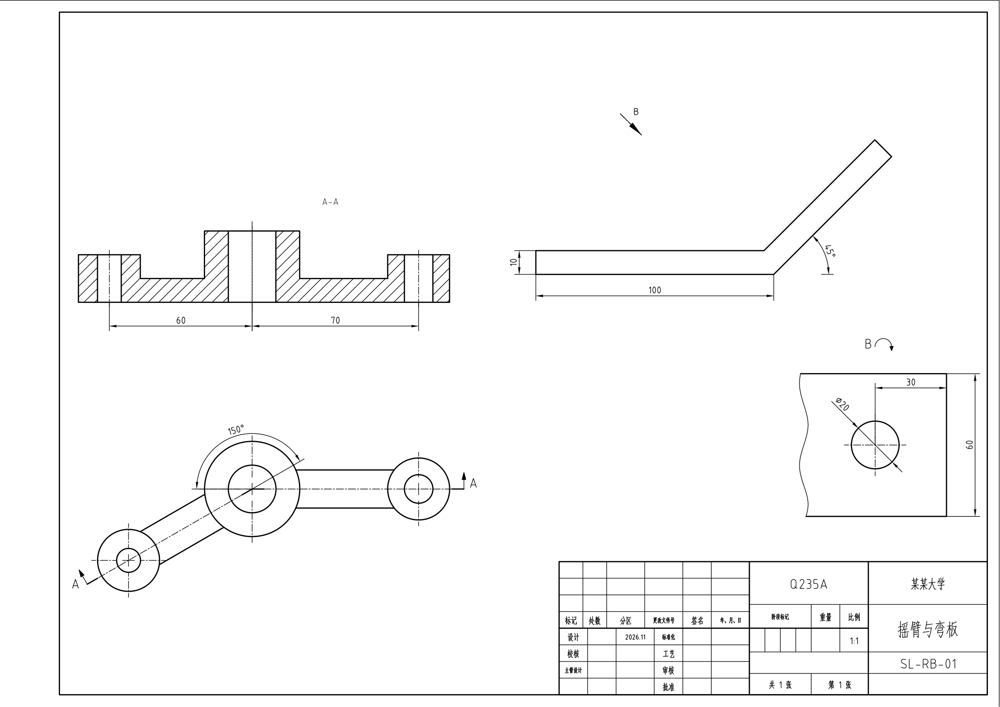 |

实心轮毂的旋转剖——剖面线按轴线裁开再拼合，两半连续无缝：

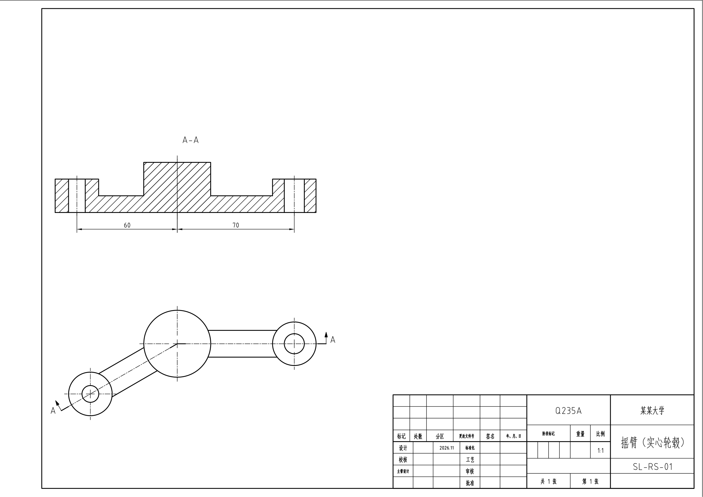

### 对应的三维模型

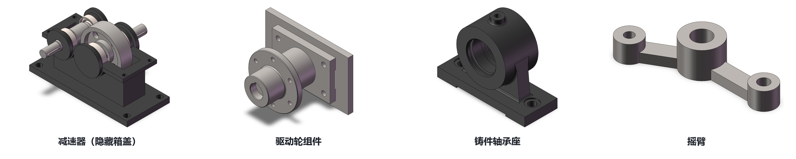

---

## 能力清单

| 领域 | 能做什么 |
|---|---|
| **视图** | 基本视图、投影视图；全剖、半剖、局部剖（波浪线）、阶梯剖、**旋转剖**（SW API 做不出国标旋转剖，用两次全剖拼接实现）；移出断面、局部放大图、斜视图、局部斜视图与转正配置；剖切符号按国标省略；肋板纵剖不画剖面线；过渡线 |
| **标注** | 线性、直径、半径、角度；半剖对称尺寸；孔旁注（沉孔、锪平、深度）；倒角；**公差查表**（GB/T 1800 / 1095 / 1804）；粗糙度（GB/T 131-2006）；基准与形位公差；GB/T 10609.1 标题栏、明细栏、零件序号、紧固件组指引线、技术要求、齿轮参数表 |
| **排版** | 尺寸自动分排（小在里、大在外，链式同排）；粗糙度 / 形位公差 / 基准 / 序号**自动放置**；尺寸数字下的点画线自动断开 |
| **规定画法** | 内外螺纹、矩形花键、压缩弹簧、圆柱齿轮（单个 / 啮合 / 装配图不剖齿轮）、锥齿轮、蜗杆蜗轮；装配图剖面线**相邻错开**、按材料换剖面符号、窄条涂黑 |
| **建模与装配** | SolidWorks 建模小工具（偏移起点切键槽、自动校验切除方向）；Toolbox GB 库**任意国标件**生成与放置；干涉检查 |
| **质量** | `check()` 压线 / 重叠 / 几何检查；`audit_dims()` 尺寸完整性审查；公差值按表复核 |
| **工程化** | 参数化出图（改参数重跑即出新图）；COM 忙时自动重试；SolidWorks 内存超限自动重开；AutoCAD 意外退出自动重启；`env_check.py` 换机自检 |

---

## 快速开始

**环境**：Windows · SolidWorks 2025（含 Toolbox、GB 模板）· AutoCAD 2024（含 `gbenor.shx` / `gbcbig.shx`）· Python 3.12。其他版本 COM 接口大体相同，但未验证。

```bash
pip install -r requirements.txt
python scripts/env_check.py        # 逐项自检；软件路径、标题栏单位等改 scripts/config.json
```

**作为 Claude Code skill 使用**：把整个目录放到 `~/.claude/skills/cad-drawing/`，然后直接说——

> “画一张减速器输出轴的零件图，Φ35k6 两处，键槽 10N9。”
> “给这个装配体出 A2 装配图，带明细栏。”

**直接跑范例**：

```bash
cd examples/reducer
python build_parts.py && python build_asm.py && python views.py && python reducer_gb.py
```

| 范例 | 演示 |
|---|---|
| `examples/reducer/` | 减速器成套图纸：装配图 + 输出轴、大齿轮、箱座、箱盖零件图（`输出轴_auto.py` 是自动放置 + 尺寸审查的标准写法） |
| `examples/zcz/` | 铸件轴承座，参数化全流程 |
| `examples/rot_oblique/` | 旋转剖拼接、局部斜视图转正 |
| `examples/wheel_assembly.py` | 小装配图：明细栏、序号、配合尺寸、剖面线错开 |
| `examples/conv_demo.py` | 规定画法样张 |
| `examples/std_demo.py` | 国标标准件生成 |
| 其余 | 回转体、板件 1:2、铸件三视图、半剖 + 局部剖 |

完整 API（`Sheet` 的全部方法）与几十条 COM 踩坑记录见 [SKILL.md](SKILL.md)。

## 目录

```
SKILL.md            skill 说明（给 Claude 看的，也是最全的文档）
scripts/
  sw_views.py       SolidWorks 出视图          sw2acad.py     AutoCAD 整理标注（Sheet）+ 自检
  sw_part.py        SolidWorks 建模            acad_common.py AutoCAD 公共部分
  sw_std.py         国标标准件生成与放置        toolbox_db.py  读 Toolbox GB 尺寸库
  gbtol.py          公差 / 键槽 / 一般公差查表  conv.py        规定画法
  gb_hatch.py       装配图剖面线               placer.py      符号自动放置
  audit.py          尺寸完整性审查             sw_mem.py      SolidWorks 内存守护
  com_filter.py     COM 忙时重试               env_check.py   环境自检
  config.json       软件路径 + 标题栏默认值
examples/           全部范例脚本
images/             本页成果图
```

## 局限

- 代码与文档在 Claude Code 中以 AI 辅助方式编写，只在作者的电脑上验证过；出的图**未经老师或专业审图人审核**。
- 自检覆盖排版与尺寸连通性；该不该剖、视图选得好不好、尺寸基准与工艺合理性，仍需要人来判断。
- 自动放置只懂“不压东西”，不懂习惯摆法，复杂图通常还要看一两轮渲染图微调。
- 零件形状大改（如新增凸台）时，参数化脚本里的标注要同步修改。
- SolidWorks / AutoCAD 的 COM 接口有不少怪问题（已记录在 SKILL.md），换版本可能遇到新的。

## 许可证

本仓库的代码、文档和图片按 [知识共享 署名-非商业性使用-相同方式共享 4.0 国际许可协议（CC BY-NC-SA 4.0）](LICENSE) 发布：

- **署名**：使用、转载或修改时须注明原作者 yun121380 和本仓库链接；
- **非商业性使用**：**禁止商用**，不得将本仓库内容或其修改版用于任何商业目的，包括售卖、付费代画图纸、付费课程/教程、集成进商业产品或收费服务；
- **相同方式共享**：基于本仓库修改后再发布的，必须使用相同的许可协议。

如需商业授权，请先通过 GitHub 联系作者取得书面许可。

SolidWorks、AutoCAD 及 Toolbox 标准件库是各自厂商的商业软件，需要自备正版授权，本仓库不包含它们的任何文件。
