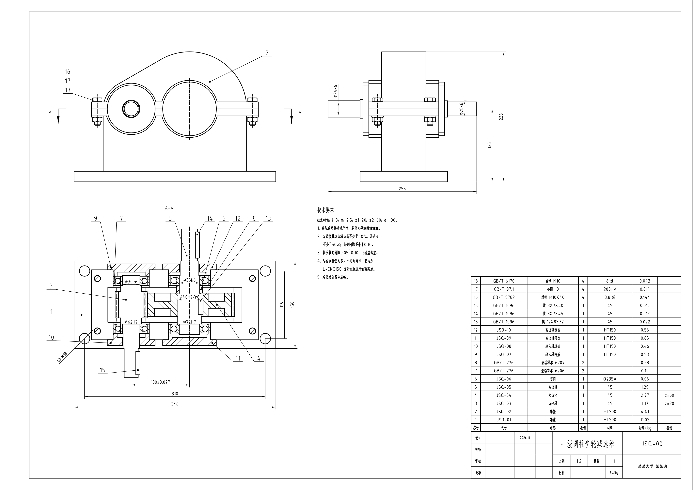
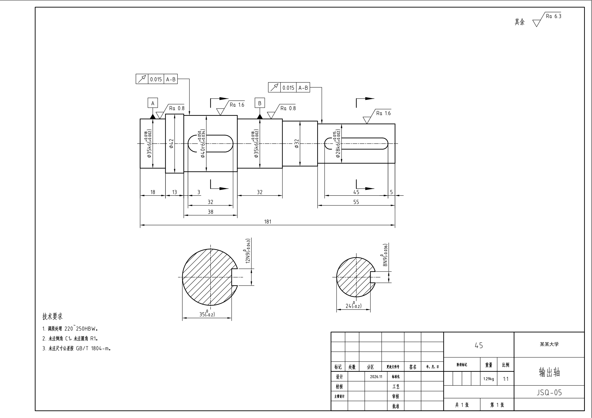
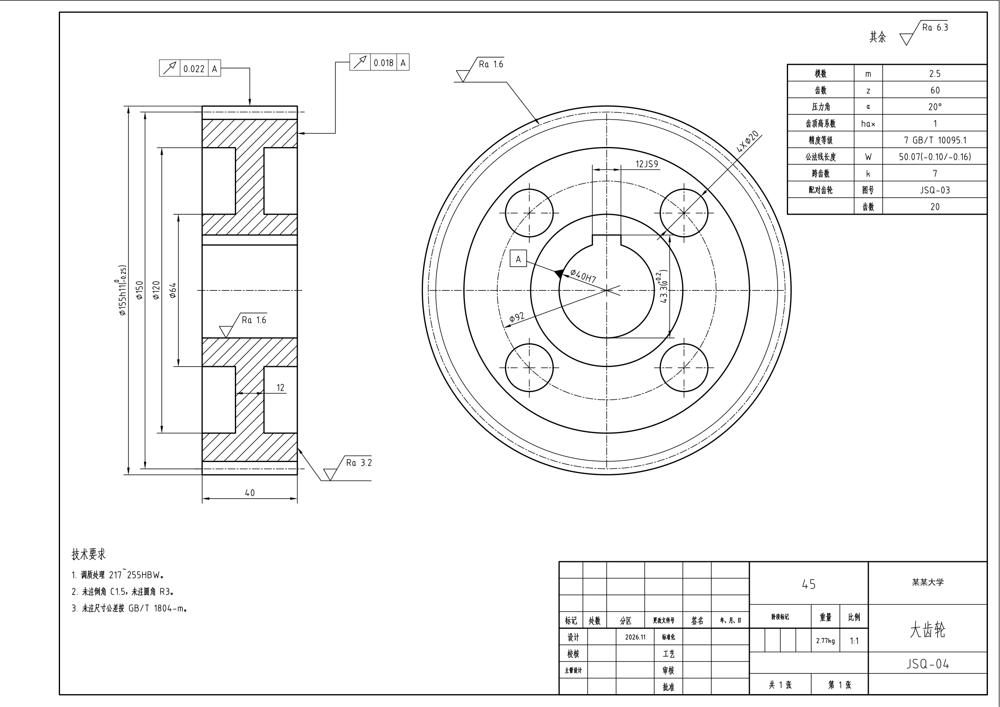
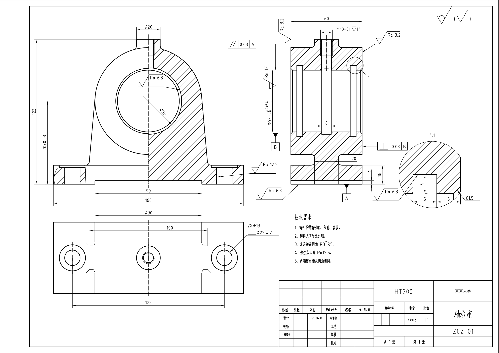
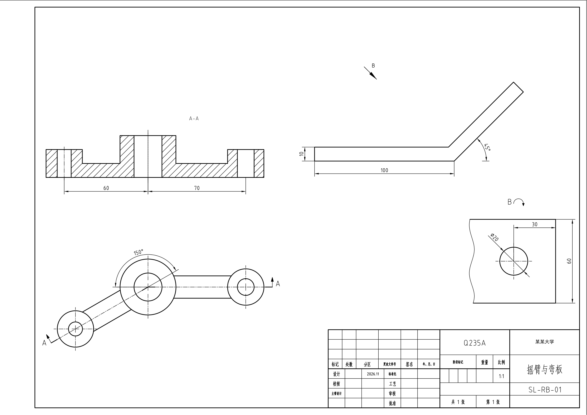
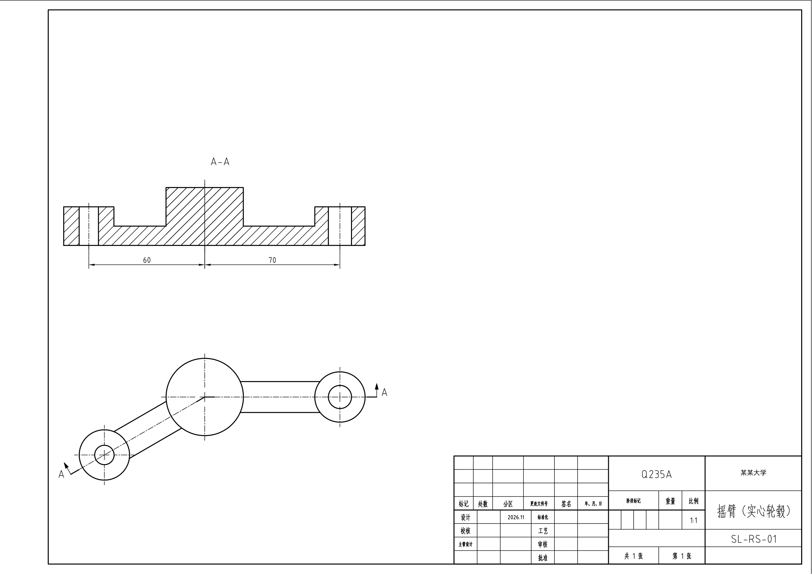

# cad-drawing：让 Claude Code 出国标机械工程图

一个 [Claude Code](https://claude.com/claude-code) skill。让 AI 通过 COM 接口驱动本机的 SolidWorks 和 AutoCAD，从三维建模一直做到符合国标的二维工程图（DWG + PDF）。整个过程不模拟键盘鼠标，跑的时候电脑可以照常用。

流程：

1. **SolidWorks** 建零件和装配，只负责出投影视图（剖视、断面、斜视图等），导出 DWG；
2. **AutoCAD** 里用 COM 整理：图层和线型按国标、标尺寸和公差、粗糙度、形位公差、基准、标题栏、明细栏、零件序号，以及螺纹和齿轮的规定画法；
3. **自动检查**：把出图栅格化，找出文字压线、文字互相重叠、尺寸线太挤、引线悬空、可能的重复标注，报出图纸坐标，改到 0 处再交。

> 代码和文档都是在 Claude Code 里用 AI 辅助写的（vibe coding），只在作者自己的电脑上验证过，没有经过专业审图。

## 成果图

一级圆柱齿轮减速器装配图（A2 1:2）。标准件从 SolidWorks Toolbox 的 GB 库按规格生成，明细栏里的代号、规格、质量都是自动填的：



| 输出轴（移出断面、自动分排尺寸、圆跳动） | 大齿轮（轮齿规定画法、参数表） |
|---|---|
|  |  |

| 铸件轴承座（半剖、局部剖、局部放大、螺纹规定画法） | 旋转剖（拼接法，斜臂按真长展开）+ 局部斜视图转正 |
|---|---|
|  |  |

实心轮毂的旋转剖（剖面线按轴线裁开再拼）：



图中标题栏的单位名称换成了占位字。

## 能做什么

- **视图**：基本视图、全剖、半剖、局部剖、阶梯剖、旋转剖、移出断面、局部放大图、斜视图和局部斜视图、转正配置。
- **标注**：线性、直径、半径、角度尺寸；极限偏差叠写；孔旁注；粗糙度（GB/T 131-2006）；基准与形位公差框格；GB/T 10609.1 标题栏；明细栏、零件序号、紧固件组公共指引线。
- **规定画法**：内螺纹，圆柱齿轮（单个及啮合），轴承的简化画法。
- **标准件**：六角头螺栓、螺母、平垫圈、普通平键、圆柱销、深沟球轴承。按规格从 Toolbox GB 基础零件生成，再放进装配。
- **参数化**：尺寸集中在一个参数文件，改参数后重跑就出新图（见 `examples/zcz/`）。

## 环境要求

- Windows，SolidWorks 2025（带 Toolbox、GB 模板），AutoCAD 2024（带 `gbenor.shx` / `gbcbig.shx`）。
- Python 3.12：`pywin32`、`PyMuPDF`、`ezdxf`、`shapely`、`numpy`、`Pillow`（B 路线另需 `pyautogui`）。
- 软件装在非默认位置时，设环境变量 `SW_EXE`、`ACAD_EXE`。
- 标题栏里的学校、班级、设计人改 `scripts/config.json`。

## 用法

把整个目录放到 `~/.claude/skills/cad-drawing/`，在 Claude Code 里说"画一张 XX 的零件图"之类的话就会触发。也可以直接跑范例：

```bash
cd examples/reducer
python build_parts.py && python build_asm.py && python views.py && python reducer_gb.py
```

详细说明、`Sheet` 的所有方法和几十条踩坑记录见 [SKILL.md](SKILL.md)。

## 目录

```
SKILL.md            skill 说明（给 Claude 看的，也是最全的文档）
scripts/
  sw_views.py       SolidWorks 出视图
  sw2acad.py        AutoCAD 整理标注（Sheet 类）+ 自动检查
  sw_part.py        SolidWorks 建模小工具
  sw_std.py         国标标准件生成与放置
  acadkb.py         备用路线：模拟键盘在 AutoCAD 里逐笔画
  com_filter.py     COM 忙时自动重试
  config.json       标题栏默认值
examples/           各类图的完整脚本（减速器成套图、轴承座、旋转剖、半剖……）
images/             上面的成果图
```

## 局限

- 尺寸自动分排只管同一方向的一组尺寸；粗糙度、形位公差框格、序号放在哪还得给坐标，复杂图一般要看 2~5 轮渲染图调整。
- 公差偏差值手写，没有接公差表。
- 弹簧、外螺纹、花键、锥齿轮、蜗轮蜗杆的规定画法还没做。
- SolidWorks 和 AutoCAD 的 COM 接口有不少怪问题（已记录在 SKILL.md），换版本可能遇到新的。
