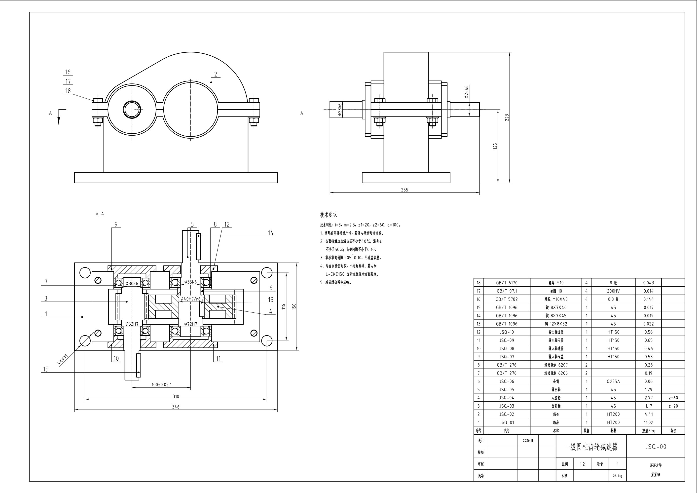
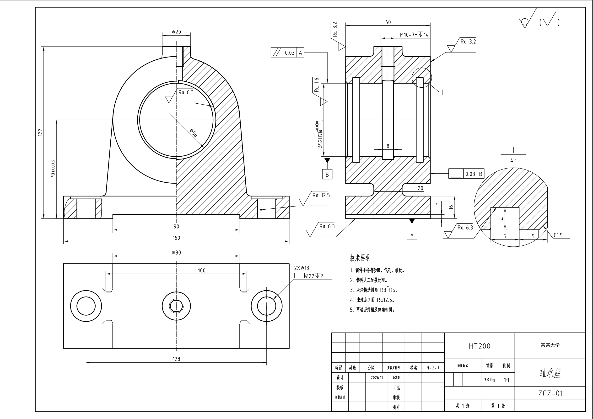

# cad-drawing：让 Claude Code 出国标机械工程图

[](LICENSE)

> ⚠️ **禁止商业化使用。** 本仓库仅供个人学习、研究和非营利用途，未经作者书面许可，不得用于任何商业目的（包括但不限于售卖、付费代画图纸、集成进商业产品或付费服务）。详见文末[许可证](#许可证)。

一个 [Claude Code](https://claude.com/claude-code) skill。AI 通过 COM 接口驱动本机的 SolidWorks 和 AutoCAD，从三维建模、装配一直做到符合国标的二维工程图（DWG + PDF）。全程不模拟键盘鼠标，跑的时候电脑可以照常用。

一句话说清楚它干什么：**你说“画一张减速器输出轴的零件图”，它建模、出视图、标尺寸公差粗糙度、填标题栏，自己检查压线和漏标，最后交一张能打印的国标图。**

## 工作流程

1. **建模**：SolidWorks 建零件和装配；标准件（螺栓、螺母、垫圈、键、销、轴承、O 形圈……）按国标规格从 Toolbox 尺寸库生成并放进装配，自动跑干涉检查。
2. **出视图**：SolidWorks 只负责投影——基本视图、全剖/半剖/局部剖/阶梯剖/旋转剖、移出断面、局部放大、斜视图，导出 DWG。可见线、剖面线、剖切符号都由 SW 算，不会漏线。
3. **整理标注**：AutoCAD 里用 COM 按国标改图层线型、画图框标题栏，标尺寸、公差、粗糙度、形位公差、基准，装配图加明细栏和序号，补螺纹、齿轮等规定画法。
4. **自动检查**：出图栅格化找文字压线和重叠；几何检查找尺寸线太挤、引线悬空；拿三维模型核对尺寸有没有标全、有没有封闭尺寸链。报 0 处再交。

## 成果图

一级圆柱齿轮减速器装配图（A2 1:2）。标准件按规格生成，明细栏里的代号、规格、质量自动填写：



| 输出轴（移出断面、自动分排尺寸、圆跳动） | 大齿轮（轮齿规定画法、参数表） |
|---|---|
|  |  |

| 铸件轴承座（半剖、局部剖、局部放大、螺纹规定画法） | 旋转剖（拼接法，斜臂按真长展开）+ 局部斜视图转正 |
|---|---|
|  |  |

实心轮毂的旋转剖（剖面线按轴线裁开再拼）：


图中标题栏的单位名称换成了占位字。

## 能力一览

### 视图与剖视
- 基本视图、投影视图、第一角画法三视图布置。
- 全剖、**半剖**、**局部剖**（波浪线）、**阶梯剖**、**旋转剖**（SW 的 API 出不了国标旋转剖，这里用两次全剖拼接，斜段按真长展开；实心轮毂也行）。
- 移出断面、局部放大图（罗马数字 + 比例）、斜视图、局部斜视图及转正配置（字母 + 旋转符号）。
- 剖切面过对称面时按国标省略剖切符号；肋板纵剖不画剖面线；过渡线改细实线。

### 标注
- 线性、直径、半径、角度尺寸；半剖里只画一半的对称尺寸；孔旁注（沉孔、锪平、深度符号）；倒角。
- **公差查表**（GB/T 1800）：写 `Φ35k6` 就自动叠写 `+0.018/+0.002`，不手抄偏差；GB/T 1095 键槽尺寸、GB/T 1804 一般公差；出图时再按表复核一遍。
- 表面粗糙度（GB/T 131-2006，含读向规则）、基准、形位公差框格。
- 标题栏（GB/T 10609.1 标准版 / 学生简化版）、明细栏（GB/T 10609.2）、零件序号、紧固件组公共指引线、技术要求、齿轮参数表。

### 自动排版
- **尺寸自动分排**：同一方向的一组尺寸按跨度从小到大分排，链式尺寸同排，小在里大在外。
- **符号自动放置**：粗糙度、形位公差、基准、装配图序号只给“标在哪个要素上”，位置自动挑——避开文字、尺寸、剖面线，序号排成一排、引线不交叉。
- 尺寸数字下的点画线自动断开。

### 规定画法
- 内外螺纹（GB/T 4459.1）、矩形花键（GB/T 4459.3）、圆柱螺旋压缩弹簧（GB/T 4459.4）。
- 圆柱齿轮单个和啮合（GB/T 4459.2），装配图里不剖的齿轮改齿顶线/分度线；直齿锥齿轮；蜗杆、蜗轮。
- **装配图剖面线**（GB/T 4457.5）：相邻零件自动错开方向或间距，同一零件各块保持一致（含局部放大图）；非金属换网格、窄条涂黑；轴、键、销等实心件不剖。

### 标准件
- 直接读 SolidWorks Toolbox 的 GB 尺寸库（SQLite），Toolbox 里有的国标件都能按规格生成（几百种），尺寸来自官方库而不是手抄；Toolbox 没有的毡圈单独建。
- 生成时写好代号、名称、规格、材料、质量等属性，明细栏直接取用。

### 质量检查
- `check()`：文字压线/重叠、平行尺寸线太挤、引线悬空、同值尺寸重复，报图纸坐标。
- `audit_dims()`：从三维模型读出平面和圆柱面，核对每个方向的尺寸是否连通（缺定位尺寸）、有没有封闭尺寸链、哪个圆柱面没标直径。

### 参数化与稳定性
- 所有尺寸放在参数文件里，标注点用模型坐标写，改参数重跑三步就出新图（`examples/zcz/`）。
- COM 忙时自动重试；SolidWorks 内存超限自动退出重开；AutoCAD 意外退出后自动重启续跑。
- `env_check.py` 换电脑后逐项自检软件路径、模板、Toolbox、字体、打印机和 Python 包，告诉你该改 `config.json` 哪一项。

## 环境要求

- Windows，SolidWorks 2025（带 Toolbox、GB 模板），AutoCAD 2024（带 `gbenor.shx` / `gbcbig.shx`）。其他版本的 COM 接口大体相同，但没有验证过。
- Python 3.12：`pip install -r requirements.txt`。
- 软件路径和标题栏默认值（单位、班级、设计人）都在 `scripts/config.json`；装好后先跑 `python scripts/env_check.py`。

## 用法

把整个目录放到 `~/.claude/skills/cad-drawing/`，在 Claude Code 里说“画一张 XX 的零件图”“出这个装配体的装配图”之类的话就会触发。

也可以直接跑范例：

```bash
cd examples/reducer
python build_parts.py && python build_asm.py && python views.py && python reducer_gb.py
```

| 范例 | 演示内容 |
|---|---|
| `examples/reducer/` | 一级圆柱齿轮减速器成套图纸：装配图 + 输出轴、大齿轮、箱座、箱盖零件图（`输出轴_auto.py` 是自动放符号 + 尺寸审查的标准写法） |
| `examples/zcz/` | 铸件轴承座，参数化全流程，半剖 + 局部剖 + 局部放大 |
| `examples/rot_oblique/` | 旋转剖拼接、局部斜视图转正 |
| `examples/bush_half*.py` | 半剖 + 局部剖 |
| `examples/conv_demo.py` | 外螺纹、花键、弹簧、锥齿轮、蜗杆蜗轮规定画法样张 |
| `examples/std_demo.py` | 各类国标标准件生成 |
| 其余 | 回转体、板件 1:2、铸件三视图、简单装配图 |

详细说明、`Sheet` 的所有方法和几十条 COM 踩坑记录见 [SKILL.md](SKILL.md)。

## 目录

```
SKILL.md            skill 说明（给 Claude 看的，也是最全的文档）
requirements.txt
scripts/
  sw_views.py       SolidWorks 出视图
  sw2acad.py        AutoCAD 整理标注（Sheet 类）+ 自动检查
  acad_common.py    AutoCAD 公共部分：COM 重试、图层/图幅、标注样式、PDF 打印配置
  conv.py           规定画法：外螺纹、花键、弹簧、锥齿轮、蜗杆蜗轮
  gb_hatch.py       装配图剖面线：相邻错开、按材料换符号
  placer.py         粗糙度/形位公差/基准/序号自动放置
  audit.py          尺寸完整性审查
  gbtol.py          GB/T 1800 公差、GB/T 1095 键槽、GB/T 1804 一般公差查表
  sw_part.py        SolidWorks 建模小工具
  sw_std.py         国标标准件生成与放置
  toolbox_db.py     读 Toolbox GB 尺寸库
  sw_mem.py         SolidWorks 内存守护
  com_filter.py     COM 忙时自动重试
  env_check.py      环境自检
  config.json       软件路径 + 标题栏默认值
examples/           各类图的完整脚本
images/             上面的成果图
```

## 局限

- 代码和文档是在 Claude Code 里用 AI 辅助写的，只在作者自己的电脑上验证过，出的图**没有经过老师或专业审图人审核**。
- 自动检查只管排版和尺寸连通性；该不该剖、视图选得好不好、尺寸基准合不合理、工艺上该不该标，还得人看。
- 自动放置只懂“别压东西”，不懂习惯摆法，复杂图一般还要看 1~2 轮渲染图微调。
- 零件形状大改（比如加一个凸台）时，参数化脚本里的标注也要跟着改。
- SolidWorks 和 AutoCAD 的 COM 接口有不少怪问题（已记录在 SKILL.md），换版本可能遇到新的。

## 许可证

本仓库的代码、文档和图片按 [知识共享 署名-非商业性使用-相同方式共享 4.0 国际许可协议（CC BY-NC-SA 4.0）](LICENSE) 发布：

- **署名**：使用、转载或修改时须注明原作者 yun121380 和本仓库链接；
- **非商业性使用**：**禁止商用**，不得将本仓库内容或其修改版用于任何商业目的，包括售卖、付费代画图纸、付费课程/教程、集成进商业产品或收费服务；
- **相同方式共享**：基于本仓库修改后再发布的，必须使用相同的许可协议。

如需商业授权，请先通过 GitHub 联系作者取得书面许可。

SolidWorks、AutoCAD 及 Toolbox 标准件库是各自厂商的商业软件，需要自备正版授权，本仓库不包含它们的任何文件。
